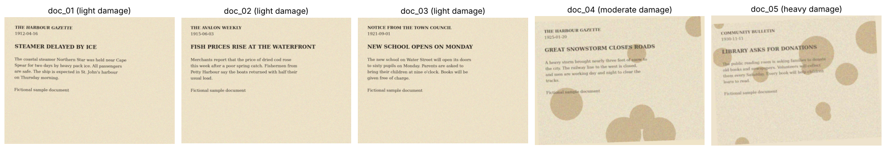
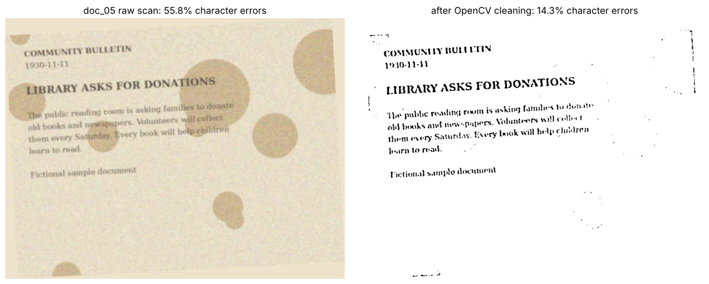

# ArchiveLens Mini

**An OCR-searchable digital archive prototype.** Scanned pages go in; clean, searchable text comes out, with a search API on top.

[](https://colab.research.google.com/github/arora2934/archivelens/blob/main/ArchiveLens_Mini.ipynb)

**🔗 Live demo: [archivelens-arora.streamlit.app](https://archivelens-arora.streamlit.app/)**

Archives hold thousands of scanned pages that nobody can search. ArchiveLens is a small, working version of the pipeline that makes them searchable: clean the scan, read it with OCR, check how accurate the OCR is, store it in a database with a full-text index, and serve search results through an API.



## Pipeline

1. **Sample scans**: 5 fictional newspaper notices, generated at three damage levels (light, moderate, heavy) with noise, stains, blur, tilt and JPEG compression.
2. **Image cleaning (OpenCV)**: grayscale, median blur, adaptive threshold.
3. **OCR (Tesseract)** on both the raw and the cleaned image.
4. **Accuracy check**: Character Error Rate (CER) against the known correct text.
5. **Storage (SQLite)**: a `documents` table with metadata and OCR text, plus an FTS5 full-text search index.
6. **Search**: ranked keyword search (BM25) with highlighted snippets and prefix matching (`snow` finds `snowstorm`).
7. **API (FastAPI)**: `GET /search?q=...` and `GET /documents/{id}`.

## Results

OCR accuracy, measured against the ground-truth text (lower CER is better):

| Document | Damage | CER raw | CER after cleaning | Accuracy after cleaning |
| --- | --- | --- | --- | --- |
| doc_01 | light | 0.0% | 0.0% | 100.0% |
| doc_02 | light | 0.0% | 0.4% | 99.6% |
| doc_03 | light | 0.0% | 0.4% | 99.6% |
| doc_04 | moderate | 14.9% | 2.5% | 97.5% |
| doc_05 | heavy | 55.8% | 14.3% | 85.7% |
| **Average** | | **14.1%** | **3.5%** | **96.5%** |

Image cleaning matters most on damaged pages: on doc_05 it cut character errors from 55.8% to 14.3%.



Example API response for `GET /search?q=steamer`:

```json
{
  "query": "steamer",
  "count": 1,
  "results": [
    {
      "id": 1,
      "source": "The Harbour Gazette",
      "date": "1912-04-16",
      "category": "Shipping",
      "snippet": "THE HARBOUR GAZETTE 1912-04-16 [STEAMER] DELAYED BY ICE The coastal...",
      "relevance": 1.507
    }
  ]
}
```

## How to run

**Easiest:** click **Open in Colab** above and run all cells.

**Web app:** run `streamlit run streamlit_app.py` to search the archive in your browser (search, OCR results, all documents).

**On your own computer:**

```bash
# 1. Install the Tesseract engine (Ubuntu: sudo apt install tesseract-ocr, Mac: brew install tesseract)
# 2. Install Python packages
pip install -r requirements.txt
# 3. Run the notebook once to build archivelens.db, then start the API
uvicorn main:app --reload
# 4. Open http://127.0.0.1:8000/docs to try the search
```

## Project files

| File | What it is |
| --- | --- |
| `ArchiveLens_Mini.ipynb` | Full pipeline, step by step, with outputs |
| `search.py` | FTS5 query building, BM25 search, document lookup |
| `main.py` | FastAPI app |
| `streamlit_app.py` | Simple web app for searching the archive |
| `archivelens.db` | SQLite database built by the notebook |
| `doc_01.png` to `doc_05.png` | The 5 generated sample scans |
| `ground_truth.json` | Correct text for each page |
| `ocr_results.csv` | OCR accuracy results |
| `sample_pages.png`, `cleaning_example.png` | Figures used in this README |

## Limitations

- Small set of 5 fictional pages, built to test the pipeline.
- OCR errors on heavily damaged pages can hide words from search. For example, "families" was read as "farmhes" on doc_05, so it cannot be found by that word.
- Keyword search finds matching words, not matching meaning.

## Next steps

- Meaning-based search with sentence embeddings, combined with keyword search (hybrid search)
- Real archive pages, used with reuse permission

## Data note

All documents in this repository are fictional and were generated by the notebook. No real archive material is included.

---
Arora Abir · Master of Artificial Intelligence student, Memorial University of Newfoundland
